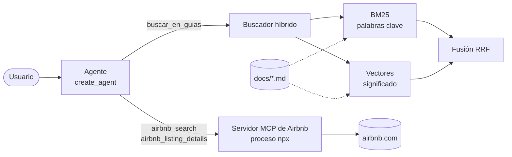

# Asistente de viajes con MCP y RAG híbrido

Ejemplo pequeño y comentado de un **agente de LangChain/LangGraph con dos fuentes de información**:

- un **servidor MCP público** (el de Airbnb) para buscar alojamientos reales, y
- un **RAG con búsqueda híbrida** (palabras clave + significado) sobre una carpeta de documentos.

El caso de uso es el asistente de una agencia ficticia, *Rumbo Sur Viajes*. Los documentos de
`docs/` (guías de destinos, política de cancelación, seguro y preguntas frecuentes) son inventados.

Todo funciona con piezas **gratuitas**: el modelo es Llama 3.3 en el plan gratuito de
[Groq](https://console.groq.com), los embeddings se calculan en tu ordenador y el servidor
de Airbnb no pide cuenta ni clave.

## Qué hace

El agente decide en cada pregunta qué herramienta necesita:

| Pregunta | Herramienta que usa |
|---|---|
| «¿Qué barrio de Lisboa es mejor para ir con niños?» | RAG (`guia_lisboa.md`) |
| «¿Puedo cancelar gratis con la tarifa RS-FLEX?» | RAG (`politica_cancelacion.md`) |
| «Busca un piso en Oporto para 2 adultos del 10 al 13 de marzo de 2027» | MCP de Airbnb |
| «Recomiéndame un barrio tranquilo de Oporto y busca alojamiento allí» | Las dos |

Al ejecutarlo se ve qué herramientas va llamando:

```text
Tú: Recomiéndame un barrio tranquilo de Oporto y busca alojamiento allí para 2 personas
  [herramienta] buscar_en_guias({'consulta': 'barrio tranquilo Oporto'})
  [herramienta] airbnb_search({'location': 'Foz do Douro, Oporto', 'adults': 2})

Asistente: Según la guía de Oporto (guia_oporto.md), Foz do Douro es la opción más tranquila...
```

> El formato es el que imprime `main.py`. Las llamadas y el texto los decide el modelo,
> así que variarán de una ejecución a otra.

## Arquitectura



### Las piezas

**El agente (`app/agente.py`).** `create_agent` de LangChain construye por debajo un grafo de
LangGraph con el bucle clásico: el modelo piensa → pide una herramienta → recibe el resultado →
vuelve a pensar, hasta que tiene la respuesta. Le pasamos una lista con todas las herramientas;
al modelo le da igual de dónde vienen.

**MCP (`app/mcp_airbnb.py`).** El *Model Context Protocol* es un estándar para ofrecer herramientas
a un modelo. El servidor es un programa independiente: aquí, el paquete de Node
[`@openbnb/mcp-server-airbnb`](https://github.com/openbnb-org/mcp-server-airbnb), que se lanza con `npx`.
`MultiServerMCPClient` lo arranca, le pregunta qué herramientas tiene y las convierte en
herramientas de LangChain. No escribimos ni una línea sobre Airbnb: solo la conexión.

**RAG híbrido (`app/rag.py`).** Los documentos se trocean por secciones y se indexan de dos formas:

| Buscador | Cómo busca | Cuándo acierta |
|---|---|---|
| BM25 | Coincidencia de palabras | Códigos y nombres exactos: `RS-FLEX`, `Triana` |
| Vectorial | Parecido de significado (embeddings) | Sinónimos: «anular la reserva» → «política de cancelación» |

Cada buscador devuelve su ranking y se fusionan con **Reciprocal Rank Fusion (RRF)**: un fragmento
recibe `1 / (60 + posición)` puntos de cada ranking y se suman. Así sube lo que ambos consideran
relevante, sin tener que comparar puntuaciones de escalas distintas. La «base de datos vectorial»
es una matriz de numpy: con 25 fragmentos no hace falta más.

**Recorte de resultados (`recortar_resultado`).** Airbnb devuelve respuestas muy largas. Un
*middleware* del agente las recorta a 6.000 caracteres antes de enviarlas al modelo, para no
superar el límite de tokens por minuto del plan gratuito.

## Estructura del proyecto

```text
.
├── main.py                 # Chat por consola; muestra qué herramientas se usan
├── app/
│   ├── config.py           # Carga .env y crea el modelo
│   ├── rag.py              # Troceado, BM25, vectores, fusión RRF y herramienta del agente
│   ├── mcp_airbnb.py       # Conexión con el servidor MCP de Airbnb
│   └── agente.py           # El agente con todas las herramientas
├── docs/                   # Los documentos inventados (6 ficheros Markdown)
├── tests/                  # Tests sin claves ni descargas (modelo y embeddings falsos)
├── requirements.txt
└── .env.example
```

Orden de lectura recomendado: `rag.py` → `mcp_airbnb.py` → `agente.py` → `main.py`.

## Puesta en marcha

Requisitos: **Python 3.10+** y **Node.js 18+** (para `npx`, que lanza el servidor MCP).

```bash
git clone https://github.com/LeoDulcetti/asistente-viajes-mcp-rag.git
cd asistente-viajes-mcp-rag

python -m venv .venv
source .venv/bin/activate        # En Windows: .venv\Scripts\activate
pip install -r requirements.txt

cp .env.example .env             # y pon tu GROQ_API_KEY dentro
```

La clave de Groq es gratuita y no pide tarjeta: crea una cuenta en
[console.groq.com](https://console.groq.com) y genera la clave en
[console.groq.com/keys](https://console.groq.com/keys).

### Ejecutar

```bash
python main.py                                              # modo conversación
python main.py "¿Qué cubre el seguro ampliado?"             # una sola pregunta
```

La primera ejecución tarda más: `npx` descarga el servidor MCP y `fastembed` descarga
el modelo de embeddings (unos 220 MB). Después quedan en caché.
Los mensajes `[INFO]` que aparecen al arrancar son el registro del servidor MCP.

### Sobre Airbnb y robots.txt

El servidor MCP respeta por defecto el `robots.txt` de Airbnb, y eso puede hacer que algunas
búsquedas se rechacen. El servidor tiene una opción para ignorarlo, que sus autores recomiendan
dejar desactivada salvo para pruebas. Si quieres activarla bajo tu responsabilidad, pon
`AIRBNB_IGNORAR_ROBOTS=true` en `.env`. Las preguntas que solo usan el RAG funcionan en cualquier caso.

### Límites del plan gratuito

Groq limita las peticiones y los tokens por minuto. Si recibes un error 429, espera unos
segundos y repite. Si el modelo por defecto deja de estar disponible, cambia `MODELO` en `.env`
por otro de la consola de Groq que soporte llamadas a herramientas.

## Tests

```bash
pytest
```

No necesitan clave de API, Node ni descargar nada: usan un modelo falso, unos embeddings
falsos (basados solo en palabras) y una herramienta que imita a la de Airbnb. Comprueban el
troceado, la búsqueda híbrida, que el agente combina las dos herramientas y que los
resultados largos se recortan.

## Cómo adaptarlo

- **Tus propios documentos:** sustituye los `.md` de `docs/`. Cada sección `## ` es un fragmento.
  Actualiza la descripción de la herramienta `buscar_en_guias` para que el modelo sepa qué contiene.
- **Otro servidor MCP:** añade otra entrada al diccionario de `MultiServerMCPClient` en
  `app/mcp_airbnb.py`. Sus herramientas se suman a las del agente sin tocar nada más.
- **Más documentos:** cambia la matriz de numpy por una base vectorial (Chroma, Qdrant, pgvector…).

## Versiones

Probado con `langchain 1.5`, `langgraph 1.2`, `langchain-mcp-adapters 0.3`, `fastembed 0.9`
y `@openbnb/mcp-server-airbnb 0.3.0` sobre Python 3.13 y Node 22.
